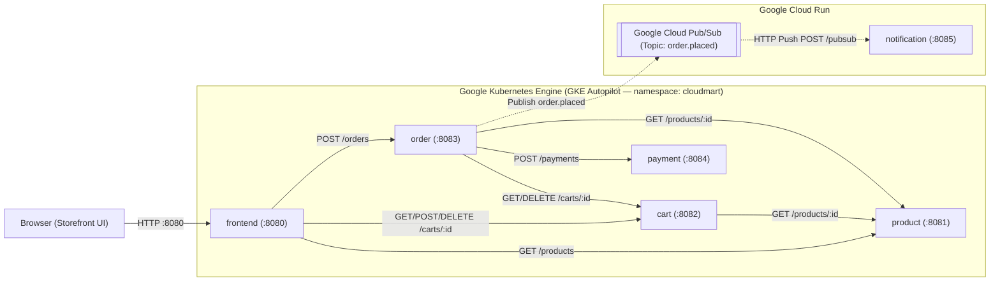

# CloudMart — Google Cloud Microservices Demo

CloudMart is a six-service e-commerce application built with **Node.js 20** and **Express** for a live conference demo on Google Cloud. Every microservice owns its isolated data and communicates with other services strictly through **HTTP REST APIs** or asynchronous **events** (`order.placed` via Google Cloud Pub/Sub).

---

## 1. Architecture Overview



### Microservices Summary

| Service | Port | Data Owned | Responsibility & Outbound Communication | Deployment Target |
| :--- | :--- | :--- | :--- | :--- |
| **frontend** | `8080` | Stateless UI (`cartId` in `localStorage`) | Serves plain HTML/CSS/JS storefront and proxies API calls to `PRODUCT_URL`, `CART_URL`, and `ORDER_URL` | GKE Autopilot (`LoadBalancer`) |
| **product** | `8081` | `src/data/products.json` (8 products in Naira `₦`) | Serves product catalogue (`GET /products`, `GET /products/:id`, `GET /healthz`) | GKE Autopilot (`ClusterIP`) |
| **cart** | `8082` | In-memory carts keyed by `cartId` | Manages customer carts (`GET/POST/DELETE /carts/:cartId`), verifying products via `PRODUCT_URL` | GKE Autopilot (`ClusterIP`) |
| **order** | `8083` | In-memory orders keyed by `orderId` | Reads cart (`CART_URL`), fetches prices (`PRODUCT_URL`), charges (`PAYMENT_URL`), clears cart, and publishes `order.placed` to `PUBSUB_TOPIC` | GKE Autopilot (`ClusterIP`) |
| **payment** | `8084` | In-memory payment transactions | Approves charges up to `₦1,000,000` (`status: "approved"`) and declines amounts over `₦1,000,000` (`status: "declined"`) | GKE Autopilot (`ClusterIP`) |
| **notification** | `8085` | In-memory notification log | Receives base64 Pub/Sub push messages at `POST /pubsub`, logs confirmation line in Naira (`₦`), and returns `204` | Google Cloud Run |

---

## 2. Folder Structure

```text
cloudmart/
├── docker-compose.yml                   # Runs all 6 services locally with *_URL env vars
├── package.json                         # Root npm workspaces & test/start scripts
├── README.md                            # Architecture, local dev, and deployment guide
├── scripts/
│   └── start-all.js                     # Local Node.js multi-service launcher
├── docs/
│   ├── product-openapi.yaml             # Product Service OpenAPI 3.0.3 contract
│   ├── cart-openapi.yaml                # Cart Service OpenAPI 3.0.3 contract
│   ├── order-openapi.yaml               # Order Service OpenAPI 3.0.3 contract
│   ├── payment-openapi.yaml             # Payment Service OpenAPI 3.0.3 contract
│   ├── notification-openapi.yaml        # Notification Service OpenAPI 3.0.3 contract
│   └── events/
│       └── order-placed.schema.json     # JSON Schema for the "order.placed" event
├── k8s/
│   ├── kustomization.yaml               # Kustomize config (centralized image registry & tag)
│   ├── namespace.yaml                   # cloudmart Namespace
│   ├── frontend.yaml                    # Deployment + LoadBalancer Service (port 80 -> 8080)
│   ├── product.yaml                     # Deployment + ClusterIP Service (port 8081)
│   ├── cart.yaml                        # Deployment + ClusterIP Service (port 8082)
│   ├── order.yaml                       # Deployment + ClusterIP Service (port 8083)
│   └── payment.yaml                     # Deployment + ClusterIP Service (port 8084)
└── services/
    ├── frontend/                        # Port 8080 — Storefront UI & BFF proxy
    │   ├── Dockerfile
    │   ├── package.json
    │   ├── src/
    │   │   ├── index.js
    │   │   └── public/index.html
    │   └── tests/frontend.test.js
    ├── product/                         # Port 8081 — 8-item Naira product catalogue
    │   ├── Dockerfile
    │   ├── package.json
    │   ├── src/
    │   │   ├── data/products.json
    │   │   ├── store.js
    │   │   └── index.js
    │   └── tests/product.test.js
    ├── cart/                            # Port 8082 — In-memory carts keyed by cartId
    │   ├── Dockerfile
    │   ├── package.json
    │   ├── src/
    │   │   ├── store.js
    │   │   └── index.js
    │   └── tests/cart.test.js
    ├── order/                           # Port 8083 — Checkout orchestrator & Pub/Sub publisher
    │   ├── Dockerfile
    │   ├── package.json
    │   ├── src/
    │   │   ├── store.js
    │   │   ├── pubsub.js
    │   │   └── index.js
    │   └── tests/order.test.js
    ├── payment/                         # Port 8084 — Mock payment processor (<= ₦1M approved)
    │   ├── Dockerfile
    │   ├── package.json
    │   ├── src/
    │   │   ├── store.js
    │   │   └── index.js
    │   └── tests/payment.test.js
    └── notification/                    # Port 8085 — Cloud Run Pub/Sub push consumer
        ├── Dockerfile
        ├── package.json
        ├── src/
        │   ├── store.js
        │   └── index.js
        └── tests/notification.test.js
```

---

## 3. Running Locally with Docker Compose

Every service includes a production-ready `Dockerfile` based on `node:20-slim`, running `npm ci --omit=dev` as the non-root `node` user.

### Start All Six Services with Docker Compose

```bash
docker compose up --build
```

This builds and starts all six containers wired with internal service URLs:
- **Storefront (`frontend`)**: `http://localhost:8080`
- **Product Service (`product`)**: `http://localhost:8081/products`
- **Cart Service (`cart`)**: `http://localhost:8082/healthz`
- **Order Service (`order`)**: `http://localhost:8083/healthz`
- **Payment Service (`payment`)**: `http://localhost:8084/healthz`
- **Notification Service (`notification`)**: `http://localhost:8085/healthz`

When running locally without `PUBSUB_TOPIC` set, the `order` service logs the `order.placed` event and pushes a base64-encoded Pub/Sub push envelope directly to `NOTIFICATION_URL/pubsub` (`http://notification:8085/pubsub`), so the `notification` container logs:

```text
Notification sent: order <orderId> confirmed for <customerEmail>, total ₦<total>
```

### Run Without Docker (Node.js 20 Direct)

```bash
npm install
npm start
```

### Run Unit Tests Across All Services

```bash
npm test
```

---

## 4. Deploying to Google Cloud

CloudMart uses a hybrid Google Cloud architecture:
- **Five core services** (`frontend`, `product`, `cart`, `order`, `payment`) run on **GKE Autopilot** in the `cloudmart` namespace.
- **One event-driven service** (`notification`) runs serverless on **Cloud Run**, triggered by a **Cloud Pub/Sub** push subscription.

### Step 1: Build and Push Container Images to Artifact Registry

```bash
export PROJECT_ID="your-gcp-project-id"
export REGION="us-central1"
export REPO="${REGION}-docker.pkg.dev/${PROJECT_ID}/cloudmart"

gcloud artifacts repositories create cloudmart \
  --repository-format=docker \
  --location="${REGION}"

for svc in frontend product cart order payment notification; do
  docker build -t "${REPO}/${svc}:v1.0.0" "./services/${svc}"
  docker push "${REPO}/${svc}:v1.0.0"
done
```

### Step 2: Create the Pub/Sub Topic

```bash
gcloud pubsub topics create order.placed --project="${PROJECT_ID}"
```

### Step 3: Deploy Five Services to GKE Autopilot (via Kustomize)

1. Edit `k8s/kustomization.yaml` (or run `kustomize edit set image`) to replace `REGION-docker.pkg.dev/PROJECT_ID/cloudmart` with your Artifact Registry path and desired image tag in one place.
2. Update `GOOGLE_CLOUD_PROJECT` in `k8s/order.yaml` to match `${PROJECT_ID}`.
3. Validate and apply the manifests:

```bash
kubectl apply -k k8s/ --dry-run=client
kubectl apply -k k8s/
```

Each GKE Deployment includes `/healthz` readiness and liveness probes, `runAsNonRoot: true`, and GKE Autopilot-sized resource requests (`250m` CPU, `512Mi` memory). Only `frontend` exposes an external `LoadBalancer` Service; `product`, `cart`, `order`, and `payment` use internal `ClusterIP` Services.

### Step 4: Deploy `notification` to Cloud Run & Wire Pub/Sub Push

```bash
gcloud run deploy notification \
  --image="${REPO}/notification:v1.0.0" \
  --region="${REGION}" \
  --platform=managed \
  --allow-unauthenticated

export NOTIFICATION_URI=$(gcloud run services describe notification \
  --region="${REGION}" \
  --format='value(status.url)')

gcloud pubsub subscriptions create order-placed-notification-sub \
  --topic=order.placed \
  --push-endpoint="${NOTIFICATION_URI}/pubsub"
```
